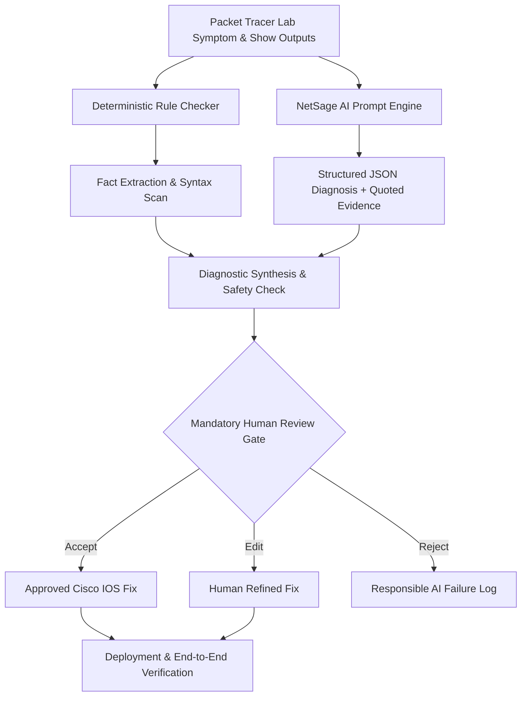

# NetSage AI: AI-Assisted Cisco Packet Tracer Troubleshooter with Human Review

[](https://www.python.org/downloads/)
[](https://streamlit.io/)
[](#human-in-the-loop-review)
[](#automated-testing)

> **In one sentence:** NetSage AI is an AI-assisted network troubleshooting helper for Cisco Packet Tracer lab problems that ingests symptoms and `show` command outputs, diagnoses root causes with evidence grounding, suggests verified Cisco IOS fixes, and **always enforces a mandatory human-in-the-loop review gate** before accepting any remediation.

---

## 🎯 Problem Statement
Junior network engineers often know individual commands but struggle to connect a symptom to the real root cause. When a PC gets an IP address but cannot reach a server, is the problem VLAN, routing, DHCP, DNS, ACL, or NAT?

**NetSage AI** bridges this gap by combining:
1. **Deterministic Rule Checking**: A Python engine that detects known configuration mistakes (e.g. duplicate IPs, wrong masks, shutdown interfaces, native VLAN mismatches, ACL shadowing).
2. **Structured AI Reasoning**: System prompts that enforce JSON schema output with strict evidence citation from `show` outputs.
3. **Mandatory Human-in-the-Loop Oversight**: Every diagnosis must be reviewed (Accepted, Edited, or Rejected) by an engineer.
4. **Responsible AI Safety Center**: Documented post-mortem analysis of AI failure modes (hallucinations, unsafe commands, asymmetric routing oversights) to prevent real-world network disruptions.

---

## 🏗️ Architecture & Workflow



---

## 📦 Project Deliverables Checklist

| Deliverable | Requirement | NetSage AI Implementation | Status |
| :--- | :--- | :--- | :--- |
| **Case Dataset** | At least 30 cases across multiple fault types | **37 realistic lab cases** in `data/cases.csv` and `data/cases.json` covering VLAN, Gateway, DHCP, DNS, Routing (OSPF, RIP, EIGRP, Static), ACL, NAT, Wireless, and Interfaces. | ✅ Complete |
| **Prompt Files** | `diagnose_prompt.md` with JSON schema & 2-3 worked examples | `prompts/diagnose_prompt.md` with strict JSON schema and **3 worked few-shot examples**, plus `verifier_prompt.md` and `human_review_guidelines.md`. | ✅ Complete |
| **Rule Checker** | Python script checking duplicate IPs, wrong masks, gateway mismatches, interfaces down, missing VLANs, missing routes | `src/rule_checker.py` modular rule engine with 15 deterministic checks achieving **100% coverage**. | ✅ Complete |
| **Dashboard** | Summary of issue types, severity, and AI vs human agreement | Interactive **Streamlit Web Application (`app.py`)** with KPI cards, Altair charts, live troubleshooter, and dataset explorer. | ✅ Complete |
| **Responsible AI Log** | Notes on at least 5 corrected AI responses | `docs/responsible_ai_log.md` and `data/responsible_ai_log.csv` documenting **6 detailed AI failure scenarios** with root causes, human overrides, and safety takeaways. | ✅ Complete |
| **Demo & Walkthrough** | 5 to 10 minutes walkthrough of broken lab diagnosis, review, fix, and verification | `docs/demo_walkthrough.md` script + interactive guided 4-stage demo tab in Streamlit. | ✅ Complete |

---

## 🚀 Quick Start & Installation

### 1. Prerequisites
- Python 3.10+ installed
- Dependencies in `requirements.txt`

### 2. Setup
```bash
# Navigate to project directory
cd netsage-ai

# Install dependencies
pip install -r requirements.txt
```

### 2b. (Optional) Enable Live AI Diagnosis — Free, No Credit Card

By default NetSage AI runs entirely offline on a deterministic reasoning engine, so it
works with zero setup and zero cost. To have real diagnoses generated by a live LLM
instead, you can plug in a **free** Groq API key (no credit card required):

1. Go to [console.groq.com/keys](https://console.groq.com/keys), sign in, and click
   "Create API Key" — the key starts with `gsk_`.
2. Set it as an environment variable before launching the app or CLI:
   ```bash
   # macOS / Linux
   export GROQ_API_KEY="gsk_your-key-here"

   # Windows (PowerShell)
   $env:GROQ_API_KEY="gsk_your-key-here"
   ```
3. Run the app or CLI as normal — `src/ai_engine.py` will automatically detect the
   key and route diagnoses through Groq (default model: `llama-3.3-70b-versatile`),
   using `prompts/diagnose_prompt.md` as the system prompt and requesting strict
   JSON output matching the project's schema.

**Safety net:** if the key is missing, the API call fails, or the free tier's rate
limit is hit, NetSage AI automatically and silently falls back to the deterministic
offline engine for that case — the app never crashes and a diagnosis is always
returned. Each diagnosis result includes an `ai_source` field (`"groq_live"` or
`"offline_reasoning_engine"`) so you can see which path produced it, which is also
useful evidence for the Responsible AI write-up.

The free Groq tier comfortably covers this project's scale (37 cases per full
evaluation run, well under the free tier's daily request limit). If you hit a rate
limit anyway, set `GROQ_MODEL=llama-3.1-8b-instant` — a smaller model with a much
higher daily request allowance on the free tier.

### 3. Launch the Interactive Web Dashboard
```bash
streamlit run app.py
```
*The web dashboard will open automatically in your browser at `http://localhost:8501`.*

### 4. Run via Command Line Interface (CLI)
```bash
# List all 37 lab cases
python cli.py --list

# Diagnose a specific case
python cli.py --case NET-010

# Run deterministic rule checker only
python cli.py --case NET-001 --rule-check

# Run batch diagnosis and benchmark evaluation
python -m src.diagnose_runner
```

### 5. Run Automated Test Suite
```bash
python -m unittest tests/test_suite.py
```

---

## 📁 Repository Structure

```
netsage-ai/
├── app.py                         # Main Streamlit Web Application
├── cli.py                         # Terminal CLI interface
├── requirements.txt               # Dependencies
├── README.md                      # Comprehensive project documentation
├── data/
│   ├── cases.csv                  # 37 Cisco Packet Tracer troubleshooting cases (CSV)
│   ├── cases.json                 # 37 cases in JSON format
│   ├── diagnosis_results.json     # AI diagnosis outputs & metrics
│   ├── eval_metrics.json          # Benchmark summary statistics
│   ├── review_log.csv             # Human reviewer audit log (Accepted/Edited/Rejected)
│   └── responsible_ai_log.csv     # 6 documented AI failure & correction records
├── prompts/
│   ├── diagnose_prompt.md         # Diagnostic prompt with schema & 3 worked examples
│   ├── verifier_prompt.md         # Post-fix verification prompt template
│   └── human_review_guidelines.md # Human reviewer triage SOP
├── src/
│   ├── __init__.py
│   ├── cases_data.py              # Master dataset aggregator
│   ├── build_data.py              # Dataset builder script
│   ├── case_manager.py            # Case filtering & review persistence manager
│   ├── ai_engine.py               # AI Diagnostic engine (API + offline network reasoning)
│   ├── diagnose_runner.py         # Batch evaluator & metrics calculator
│   ├── rule_checker.py            # Deterministic Cisco config rule validation engine
│   ├── rules/
│   │   ├── rules_l1_l2.py         # Layer 1 & 2 rules (shutdown, trunk, native VLAN, DTP, Wi-Fi)
│   │   ├── rules_l3.py            # Layer 3 rules (IP conflict, masks, gateways, OSPF, NAT)
│   │   └── rules_l4_l7.py         # Layer 4 & 7 rules (ACL implicit deny, DHCP, DNS)
│   └── ui/
│       ├── dashboard_view.py      # Analytics & KPI dashboard
│       ├── troubleshooter_view.py # Interactive live troubleshooter & review console
│       ├── responsible_ai_view.py # Responsible AI safety center & audit log
│       ├── case_explorer_view.py  # Dataset browser & export tool
│       └── demo_view.py           # 4-stage guided broken lab walkthrough
├── tests/
│   ├── __init__.py
│   └── test_suite.py              # Automated test suite (6 passing test cases)
└── docs/
    ├── responsible_ai_log.md      # Detailed failure taxonomy & responsible AI analysis
    └── demo_walkthrough.md        # 5-10 minute video demo script & lab walkthrough
```

---

## 🛡️ Responsible AI & Safety Principles

1. **Mandatory Human Sign-Off**: Automated remediations are never executed without an engineer's validation.
2. **Evidence Quotation Requirement**: Every claim made by the assistant must quote verbatim lines from `show` outputs.
3. **Deterministic Rules as Guardrails**: Rule checker runs pre-AI to prevent hallucinations regarding fundamental physical and data-link states.
4. **Transparent Failure Analysis**: At least 6 AI error scenarios are documented with full post-mortem analysis (e.g. Asymmetric routing blindspots, Hallucinated interface IDs, Inverted wildcard masks).